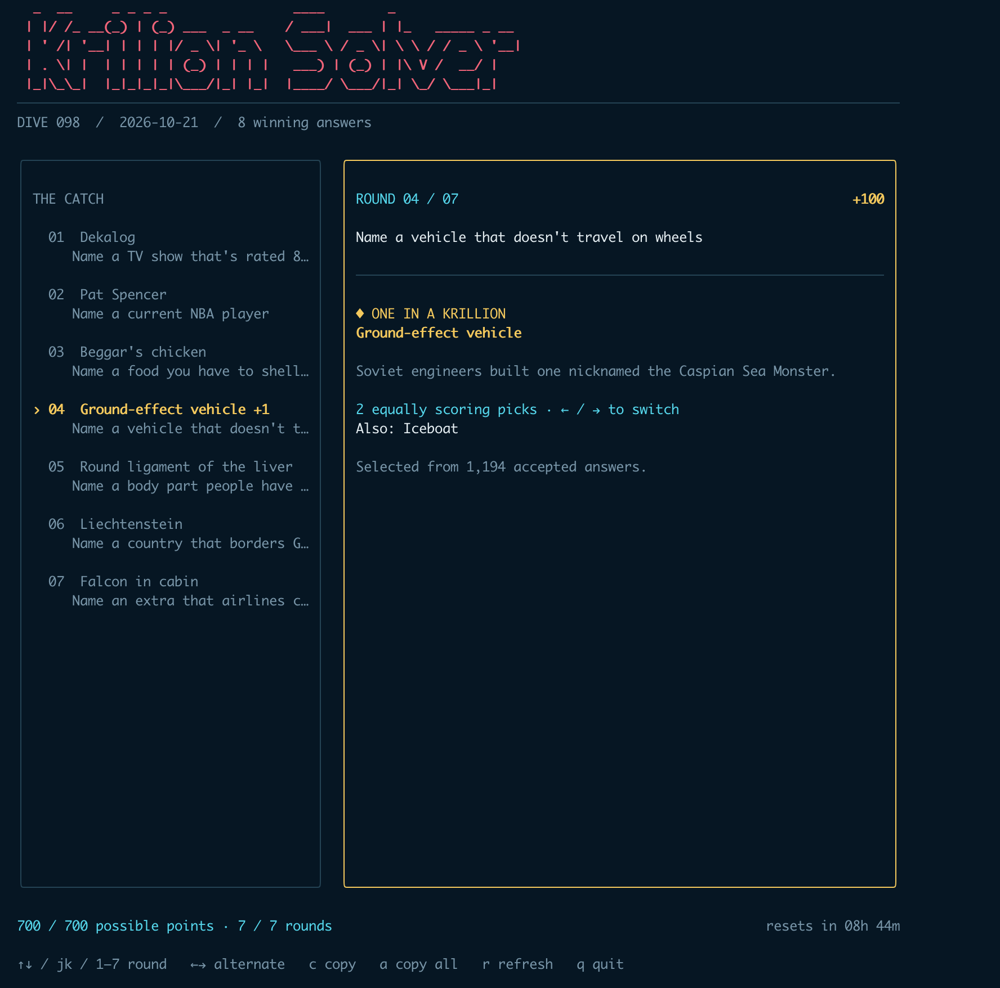

# Krillion Solver

An unofficial solver for [Krillion](https://krillion.io/). See today's seven prompts and their top answers, read each description, switch between equal picks, and copy an answer or the full list. If a round has no One in a Krillion answer, the app labels its highest-scoring available pick.



## Run

[Download a macOS, Linux, or Windows build](https://github.com/owenHochwald/krillion-solver/releases/latest), or build from source with Go 1.25 or later:

```sh
make
./krillion
```

On Windows without Make:

```powershell
go build -o krillion.exe .
.\krillion.exe
```

Use `↑`/`↓` or `j`/`k` to move between prompts, `←`/`→` to switch alternate answers, `c` to copy the selected answer, and `a` to copy every answer.

`make release` builds macOS, Linux, and Windows binaries in `dist/`.

## Browser app

Run the Go HTTP app locally with `make web`, then open <http://127.0.0.1:8080>. Use `go run . --web --demo` to preview illustrative data without reaching Krillion. The app serves its HTML, CSS, and JavaScript from the binary and uses the same Go solver as the TUI for `/data.json`. Change the listen address with `--addr`.

For public hosting, the included GitHub Pages workflow builds a static copy of the same interface and generates `data.json` with `go run . --json`. GitHub Pages cannot run a Go HTTP server, so the workflow updates the answers hourly and on pushes to `main`. The page shows the puzzle date so visitors can tell which dive is published. A failed fetch leaves the previous successful deployment online.

To publish it:

1. Push the commits to `main` on GitHub.
2. In the repository, open **Settings → Pages** and choose **GitHub Actions** under **Build and deployment**.
3. Run **Actions → Publish web app → Run workflow** once, or wait for the push workflow. The site will appear at <https://owenHochwald.github.io/krillion-solver/>.

The workflow needs public access to Krillion's `/api/today` and `/api/reveal` endpoints. GitHub's scheduled runs can start late, so the new puzzle may appear after its reset time. Use the workflow's manual run button to refresh it sooner.

## macOS menu bar app

The TUI also has a companion menu bar app for macOS 14 or later. Click its shrimp icon to see all seven answers in a compact panel, expand a round for the prompt and alternate winners, or copy an answer. It works alongside any browser.

With Xcode installed, run:

```sh
make macos-app
open dist/xcode/Build/Products/Release/KrillionBar.app
```

The app uses the same daily Krillion endpoints and validation rules as the TUI. The generated Xcode project is also at `macos/KrillionBar.xcodeproj`; edit its source files under `macos/KrillionBar/`. The local `make macos-app` build is unsigned. A distributed build needs normal macOS signing and notarization.
